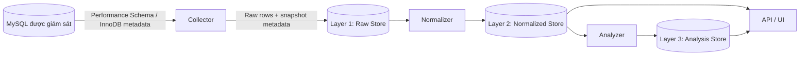
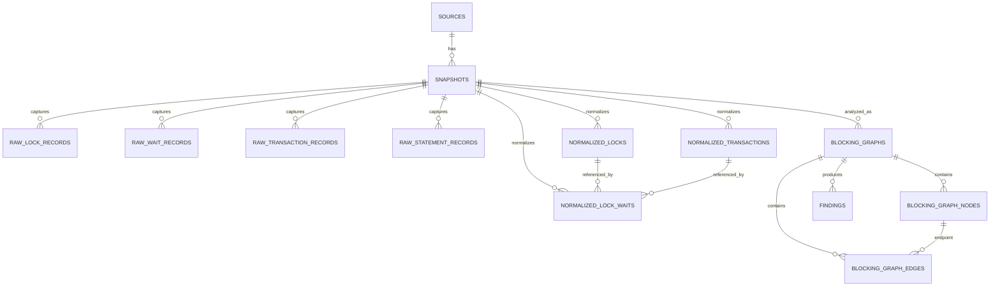

# DBLens — Tài liệu ERD và mô hình dữ liệu

> **Trạng thái:** Thiết kế đề xuất cho MVP  
> **Phạm vi ban đầu:** MySQL 8.0+  
> **Database lưu trữ của DBLens:** PostgreSQL  
> **Ngôn ngữ triển khai:** Go

---

## 1. Mục đích

DBLens thu thập dữ liệu chẩn đoán từ MySQL, lưu dữ liệu nguồn ở Layer 1, chuẩn hóa ở Layer 2 và phân tích tình trạng lock contention ở Layer 3.

Tài liệu này tập trung vào:

- Mục đích, cách sử dụng và ý nghĩa từng cột trong các bảng ERD.
- Các cột thực tế được thu thập từ MySQL và lưu trong `payload` của từng bảng Raw.
- Ý nghĩa của từng cột nguồn trong `performance_schema` và `information_schema`.
- Quan hệ giữa các layer, quy trình xử lý và các lưu ý khi triển khai.


## 2. Nguyên tắc thiết kế

1. **Layer 1 giữ dữ liệu nguồn:** `payload` chứa các cột lấy từ bảng/view MySQL tương ứng. Không cần lặp lại trong `payload` những thông tin DBLens đã lưu ở các cột ngoài như `snapshot_id` hoặc `collected_at`.
2. **Layer 2 chuẩn hóa:** Chuyển các cột MySQL thành domain model nhất quán của DBLens.
3. **Layer 3 lưu kết quả phân tích:** Blocking graph và findings là dữ liệu suy ra, có thể được tạo lại từ Layer 2.
4. **ID từ MySQL không phải ID DBLens:** `THREAD_ID`, `PROCESSLIST_ID`, transaction ID và lock ID có phạm vi/ý nghĩa khác nhau. Không dùng trực tiếp làm khóa chính nội bộ.
5. **Snapshot là trạng thái được quan sát:** Không phải event log đầy đủ. Lock xuất hiện rồi biến mất giữa hai lần polling có thể không được ghi nhận.
6. **Chú ý dữ liệu nhạy cảm:** SQL text, user, host và lock data có thể chứa thông tin nhạy cảm. Nên hỗ trợ redaction và retention.


## 3. Kiến trúc tổng quan




### Layer 1 — Raw Store

Lưu các cột được thu thập từ các bảng/view nguồn của MySQL, giữ tên và giá trị nguồn càng sát càng tốt. DBLens vẫn cần metadata riêng như `snapshot_id` và `collected_at` để quản lý batch và thời gian thu thập, nhưng không cần lặp lại chúng trong `payload`.

### Layer 2 — Normalized Store

Chuyển các cột nguồn thành các entity chuẩn như lock, transaction và lock wait. Layer này giúp Analyzer không phụ thuộc trực tiếp vào tên cột riêng của MySQL.

### Layer 3 — Analysis Store

Lưu blocking graph, node, edge và các finding do Analyzer tạo ra.

---


## 4. Các nguồn MySQL được sử dụng


| Bảng Raw của DBLens       | Nguồn MySQL chính                                                            | Dữ liệu thu thập                                                                               |
| ------------------------- | ---------------------------------------------------------------------------- | ---------------------------------------------------------------------------------------------- |
| `raw_lock_records`        | `performance_schema.data_locks`                                              | Thông tin lock, object, mode, status, thread và transaction liên quan.                         |
| `raw_wait_records`        | `performance_schema.data_lock_waits`                                         | Quan hệ giữa lock đang được yêu cầu và lock đang chặn nó.                                      |
| `raw_transaction_records` | `information_schema.innodb_trx`, có thể bổ sung `performance_schema.threads` | Trạng thái transaction, thời gian bắt đầu, thời gian chờ, connection/thread và query hiện tại. |
| `raw_statement_records`   | `performance_schema.events_statements_current`; history tables là tùy chọn   | SQL text/digest, timing và các bộ đếm statement nếu có.                                        |


**Lưu ý tương thích:** Tài liệu này mô tả MySQL 8.0+. MySQL 5.7 dùng các nguồn lock khác, thường gồm `information_schema.innodb_locks` và `information_schema.innodb_lock_waits`. Cần adapter riêng nếu hỗ trợ 5.7. Các cột có thể khác theo phiên bản, vì vậy Collector nên kiểm tra schema thực tế.

**Lưu ý quyền:** Dùng tài khoản chỉ đọc với quyền tối thiểu. `PROCESS` có phạm vi khá rộng; cần DBA duyệt trước khi cấp. Không tự bật instrumentation hoặc thay đổi cấu hình MySQL production.

---


## 5. Layer 1 — Raw Store


### 5.1. `sources`

**Mục đích:** Danh mục các database được DBLens giám sát.

**Dùng để:** Gắn snapshot với database nguồn, quản lý cấu hình collector và chính sách thu thập.

**Nguồn dữ liệu:** Được tạo/quản lý bởi DBLens, không lấy từ MySQL.


| Cột          | Ý nghĩa                                                                                                         |
| ------------ | --------------------------------------------------------------------------------------------------------------- |
| `id`         | Khóa chính nội bộ do DBLens sinh ra.                                                                            |
| `name`       | Tên dễ nhận biết, ví dụ `payments-staging`.                                                                     |
| `db_type`    | Loại database, ban đầu là `mysql`.                                                                              |
| `config`     | Cấu hình không nhạy cảm như host, port, database name và tùy chọn collector. Không lưu password dạng plaintext. |
| `created_at` | Thời điểm đăng ký source.                                                                                       |


### 5.2. `snapshots`

**Mục đích:** Đại diện cho một lần thu thập dữ liệu từ một source.

**Dùng để:** Nhóm raw records, theo dõi trạng thái collection/normalization và retry khi xử lý lỗi.

**Nguồn dữ liệu:** Do Collector tạo và cập nhật.


| Cột                   | Ý nghĩa                                                                                        |
| --------------------- | ---------------------------------------------------------------------------------------------- |
| `id`                  | ID snapshot do DBLens sinh ra.                                                                 |
| `source_id`           | FK đến `sources.id`, xác định database được thu thập.                                          |
| `capture_started_at`  | Thời điểm bắt đầu thu thập.                                                                    |
| `capture_finished_at` | Thời điểm kết thúc thu thập; có thể `NULL` nếu chưa hoàn tất.                                  |
| `status`              | Trạng thái đề xuất: `collecting`, `collected`, `processing`, `processed`, `failed`.            |
| `attempt_count`       | Số lần worker thử xử lý snapshot; cần định nghĩa rõ là số lần normalize hay tổng số lần xử lý. |
| `last_error`          | Lỗi gần nhất, không chứa secret hoặc SQL nhạy cảm.                                             |
| `processed_at`        | Thời điểm normalize thành công.                                                                |


Index đề xuất:

- `(source_id, capture_started_at DESC)` để truy vấn lịch sử source.
- `(status, capture_started_at)` để worker tìm snapshot cần xử lý.


### 5.3. Cách thiết kế `payload`

`payload` nên chứa **các cột thực tế lấy từ bảng/view MySQL tương ứng**, không cần chứa lại các metadata DBLens đã có ở cột ngoài.

Ví dụ `raw_wait_records` có:

- `snapshot_id`: đã có ở bảng Raw.
- `collected_at`: đã có ở bảng Raw.
- `payload`: chỉ chứa các cột từ `performance_schema.data_lock_waits`.

Ví dụ payload:

```json
{
  "ENGINE": "INNODB",
  "REQUESTING_ENGINE_LOCK_ID": "140123:42:7:9",
  "REQUESTING_ENGINE_TRANSACTION_ID": "987654",
  "REQUESTING_THREAD_ID": 71,
  "REQUESTING_EVENT_ID": 42,
  "REQUESTING_OBJECT_INSTANCE_BEGIN": "140123456",
  "BLOCKING_ENGINE_LOCK_ID": "140123:42:7:8",
  "BLOCKING_ENGINE_TRANSACTION_ID": "987650",
  "BLOCKING_THREAD_ID": 65,
  "BLOCKING_EVENT_ID": 37,
  "BLOCKING_OBJECT_INSTANCE_BEGIN": "140123455"
}
```

Đây là JSON biểu diễn một dòng nguồn. Khi triển khai, nên serialize kết quả truy vấn bằng cách giữ tên cột MySQL. Với identifier lớn, ưu tiên cách serialize không làm mất độ chính xác; một số ID có thể được lưu dạng chuỗi trong JSON.

**Không đưa vào** `payload` **mặc định:** `snapshot_id`, `collected_at`, `source_id` hoặc các trường quản lý nội bộ DBLens. Nếu sau này cần lưu provenance chi tiết như server version hoặc tên bảng nguồn, có thể đặt metadata đó ở cột riêng hoặc thêm envelope có chủ đích, nhưng tránh lặp lại thông tin đã có.

### 5.4. `raw_lock_records`

**Mục đích:** Lưu từng dòng lock được MySQL cung cấp.

**Nguồn:** `performance_schema.data_locks`.

**Dùng để:** Biết lock nào tồn tại, lock thuộc object nào, mode/status ra sao và liên kết với transaction/thread nào.


| Cột DBLens     | Ý nghĩa                                                      |
| -------------- | ------------------------------------------------------------ |
| `id`           | ID dòng nội bộ của DBLens.                                   |
| `snapshot_id`  | Snapshot chứa dòng raw.                                      |
| `payload`      | JSONB gồm các cột nguồn của `performance_schema.data_locks`. |
| `collected_at` | Thời điểm DBLens ghi nhận dòng này.                          |


#### Schema `payload` — `performance_schema.data_locks`

Ví dụ:

```json
{
  "ENGINE": "INNODB",
  "ENGINE_LOCK_ID": "140123:42:7:9",
  "ENGINE_TRANSACTION_ID": "987654",
  "THREAD_ID": 71,
  "EVENT_ID": 42,
  "OBJECT_SCHEMA": "app",
  "OBJECT_NAME": "orders",
  "PARTITION_NAME": null,
  "SUBPARTITION_NAME": null,
  "INDEX_NAME": "PRIMARY",
  "OBJECT_INSTANCE_BEGIN": "140123456",
  "LOCK_TYPE": "RECORD",
  "LOCK_MODE": "X,REC_NOT_GAP",
  "LOCK_STATUS": "GRANTED",
  "LOCK_DATA": "123"
}
```


| Cột nguồn               | Ý nghĩa                                                                                                                         |
| ----------------------- | ------------------------------------------------------------------------------------------------------------------------------- |
| `ENGINE`                | Storage engine gắn với lock, thường là `INNODB`.                                                                                |
| `ENGINE_LOCK_ID`        | Định danh lock do engine cung cấp. Xem là opaque và chỉ dùng trong ngữ cảnh nguồn/snapshot; không dùng làm PK DBLens.           |
| `ENGINE_TRANSACTION_ID` | Transaction ID InnoDB liên quan đến lock, nếu có. Có thể được trả về dạng số/chuỗi; cần bảo toàn độ chính xác.                  |
| `THREAD_ID`             | ID thread nội bộ của Performance Schema. Không phải `PROCESSLIST_ID`/connection ID.                                             |
| `EVENT_ID`              | ID event trong thread nếu có. Hữu ích khi đối chiếu với statement event.                                                        |
| `OBJECT_SCHEMA`         | Schema chứa đối tượng bị lock.                                                                                                  |
| `OBJECT_NAME`           | Tên bảng/đối tượng bị lock.                                                                                                     |
| `PARTITION_NAME`        | Tên partition nếu đối tượng thuộc partition.                                                                                    |
| `SUBPARTITION_NAME`     | Tên subpartition nếu có.                                                                                                        |
| `INDEX_NAME`            | Index liên quan đến lock nếu có.                                                                                                |
| `OBJECT_INSTANCE_BEGIN` | Địa chỉ/định danh instance nội bộ do MySQL cung cấp. Xem như opaque, không dùng làm định danh bền vững qua snapshot.            |
| `LOCK_TYPE`             | Loại lock, thường là `TABLE` hoặc `RECORD`.                                                                                     |
| `LOCK_MODE`             | Mode lock do MySQL báo cáo, ví dụ `S`, `X`, `IS`, `IX` hoặc mode chi tiết như `X,REC_NOT_GAP`. Giữ nguyên giá trị nguồn ở Raw.  |
| `LOCK_STATUS`           | Trạng thái lock, thường là `GRANTED` hoặc `WAITING`.                                                                            |
| `LOCK_DATA`             | Dữ liệu gắn với lock, có thể là giá trị khóa index. Có thể `NULL` và có thể làm lộ dữ liệu nghiệp vụ; cân nhắc che hoặc bỏ qua. |


**Ghi chú:** Tập cột và giá trị thực tế cần được xác minh theo phiên bản MySQL. Collector nên lưu các cột mà truy vấn nguồn thực sự trả về, không tự điền các cột không tồn tại.

### 5.5. `raw_wait_records`

**Mục đích:** Lưu quan hệ giữa lock đang được yêu cầu và lock đang chặn nó.

**Nguồn:** `performance_schema.data_lock_waits`.

**Dùng để:** Xác định waiter/blocker và làm đầu vào xây dựng `normalized_lock_waits`.


| Cột DBLens     | Ý nghĩa                                                           |
| -------------- | ----------------------------------------------------------------- |
| `id`           | ID dòng nội bộ DBLens.                                            |
| `snapshot_id`  | Snapshot chứa dòng raw.                                           |
| `payload`      | JSONB gồm các cột nguồn của `performance_schema.data_lock_waits`. |
| `collected_at` | Thời điểm DBLens ghi nhận dòng này.                               |


#### Schema `payload` — `performance_schema.data_lock_waits`

Ví dụ:

```json
{
  "ENGINE": "INNODB",
  "REQUESTING_ENGINE_LOCK_ID": "140123:42:7:9",
  "REQUESTING_ENGINE_TRANSACTION_ID": "987654",
  "REQUESTING_THREAD_ID": 71,
  "REQUESTING_EVENT_ID": 42,
  "REQUESTING_OBJECT_INSTANCE_BEGIN": "140123456",
  "BLOCKING_ENGINE_LOCK_ID": "140123:42:7:8",
  "BLOCKING_ENGINE_TRANSACTION_ID": "987650",
  "BLOCKING_THREAD_ID": 65,
  "BLOCKING_EVENT_ID": 37,
  "BLOCKING_OBJECT_INSTANCE_BEGIN": "140123455"
}
```


| Cột nguồn                          | Ý nghĩa                                                                                                                        |
| ---------------------------------- | ------------------------------------------------------------------------------------------------------------------------------ |
| `ENGINE`                           | Storage engine của quan hệ chờ, thường là `INNODB`.                                                                            |
| `REQUESTING_ENGINE_LOCK_ID`        | ID lock mà transaction đang yêu cầu nhưng chưa được cấp. Có thể đối chiếu với `data_locks.ENGINE_LOCK_ID` trong cùng snapshot. |
| `REQUESTING_ENGINE_TRANSACTION_ID` | Transaction ID của bên yêu cầu lock.                                                                                           |
| `REQUESTING_THREAD_ID`             | Performance Schema thread ID của bên đang chờ.                                                                                 |
| `REQUESTING_EVENT_ID`              | Event ID của thao tác yêu cầu lock nếu có.                                                                                     |
| `REQUESTING_OBJECT_INSTANCE_BEGIN` | Địa chỉ/định danh instance của lock được yêu cầu nếu có. Xem là opaque.                                                        |
| `BLOCKING_ENGINE_LOCK_ID`          | ID lock đang chặn yêu cầu.                                                                                                     |
| `BLOCKING_ENGINE_TRANSACTION_ID`   | Transaction ID của bên giữ lock chặn.                                                                                          |
| `BLOCKING_THREAD_ID`               | Performance Schema thread ID của bên đang chặn.                                                                                |
| `BLOCKING_EVENT_ID`                | Event ID của thao tác blocking nếu có.                                                                                         |
| `BLOCKING_OBJECT_INSTANCE_BEGIN`   | Địa chỉ/định danh instance của lock chặn nếu có. Xem là opaque.                                                                |


**Cách hiểu:** Một dòng trong `data_lock_waits` là một quan hệ wait, không phải bản mô tả đầy đủ của lock. Cần đối chiếu với `data_locks` để lấy mode, object và status. Vì trạng thái có thể thay đổi trong lúc Collector truy vấn, không đảm bảo mọi bản ghi ở hai nguồn đều có thể ghép được hoàn hảo.

### 5.6. `raw_transaction_records`

**Mục đích:** Lưu thông tin transaction và session để giải thích ai đang chờ, ai đang chặn và transaction đã chạy bao lâu.

**Nguồn chính:** `information_schema.innodb_trx`; có thể bổ sung `performance_schema.threads` để ánh xạ thread ID với connection ID và lấy ngữ cảnh session.

**Dùng để:** Tạo `normalized_transactions` và bổ sung ngữ cảnh cho blocking graph.


| Cột DBLens     | Ý nghĩa                                                                                                          |
| -------------- | ---------------------------------------------------------------------------------------------------------------- |
| `id`           | ID dòng Raw nội bộ DBLens.                                                                                       |
| `snapshot_id`  | Snapshot chứa bản ghi.                                                                                           |
| `payload`      | JSONB gồm các cột nguồn transaction. Nếu ghép nhiều nguồn, nên chia object theo tên nguồn để tránh nhầm lẫn cột. |
| `collected_at` | Thời điểm DBLens ghi nhận dòng này.                                                                              |


Có hai cách triển khai:

1. **Một payload chỉ chứa một dòng nguồn:** lưu dòng `innodb_trx` trong `raw_transaction_records`, và lưu thread/session metadata ở bảng raw riêng hoặc `raw_statement_records`.
2. **Payload tổng hợp:** ghép dòng `innodb_trx` với dòng thread tương ứng, nhưng cần đánh dấu rõ mỗi nhóm cột đến từ bảng nào.

Để raw data dễ audit và tránh nhập nhằng, MVP nên ưu tiên cách 1 nếu không có lý do rõ ràng để tổng hợp.

#### Schema `payload` — `information_schema.innodb_trx`

Ví dụ:

```json
{
  "trx_id": "987654",
  "trx_state": "LOCK WAIT",
  "trx_started": "2026-10-09 10:00:00",
  "trx_requested_lock_id": "140123:42:7:9",
  "trx_wait_started": "2026-10-09 10:00:05",
  "trx_weight": 2,
  "trx_mysql_thread_id": 71,
  "trx_query": "UPDATE orders SET status = 'paid' WHERE id = 123",
  "trx_operation_state": "fetching rows",
  "trx_tables_in_use": 1,
  "trx_tables_locked": 1,
  "trx_lock_structs": 4,
  "trx_lock_memory_bytes": 1136,
  "trx_rows_locked": 2,
  "trx_rows_modified": 1,
  "trx_concurrency_tickets": 0,
  "trx_isolation_level": "REPEATABLE READ",
  "trx_unique_checks": 1,
  "trx_foreign_key_checks": 1,
  "trx_last_foreign_key_error": null,
  "trx_adaptive_hash_latched": 0,
  "trx_adaptive_hash_timeout": 0,
  "trx_is_read_only": 0,
  "trx_autocommit_non_locking": 0,
  "trx_schedule_weight": null
}
```

Các cột `information_schema.innodb_trx` có thể khác theo phiên bản. Hãy kiểm tra schema của đúng MySQL version mà DBLens hỗ trợ.


| Cột nguồn                    | Ý nghĩa                                                                                                                                |
| ---------------------------- | -------------------------------------------------------------------------------------------------------------------------------------- |
| `trx_id`                     | ID transaction InnoDB. Đây là ID nguồn, không phải PK DBLens.                                                                          |
| `trx_state`                  | Trạng thái transaction, ví dụ `RUNNING` hoặc `LOCK WAIT`.                                                                              |
| `trx_started`                | Thời điểm transaction bắt đầu. Dùng để tính tuổi transaction.                                                                          |
| `trx_requested_lock_id`      | ID lock mà transaction đang chờ, nếu có. Có thể đối chiếu với lock ID nguồn.                                                           |
| `trx_wait_started`           | Thời điểm bắt đầu chờ lock, nếu đang chờ.                                                                                              |
| `trx_weight`                 | Trọng số transaction theo cách InnoDB dùng để đánh giá chi phí rollback tương đối; không phải thời gian chờ.                           |
| `trx_mysql_thread_id`        | MySQL connection/processlist ID gắn với transaction. Khác với Performance Schema `THREAD_ID`.                                          |
| `trx_query`                  | Query hiện tại của transaction nếu có. Có thể chứa literal nhạy cảm.                                                                   |
| `trx_operation_state`        | Trạng thái thao tác InnoDB hiện tại nếu có.                                                                                            |
| `trx_tables_in_use`          | Số bảng transaction đang sử dụng theo metadata InnoDB.                                                                                 |
| `trx_tables_locked`          | Số bảng transaction đã lock theo metadata InnoDB.                                                                                      |
| `trx_lock_structs`           | Số cấu trúc lock mà transaction đang giữ/quản lý.                                                                                      |
| `trx_lock_memory_bytes`      | Lượng bộ nhớ được dùng cho cấu trúc lock của transaction, nếu cột có mặt.                                                              |
| `trx_rows_locked`            | Số row đang bị lock theo metadata InnoDB. Đây là chỉ số engine báo cáo, không nên diễn giải như số row duy nhất đã xác minh tuyệt đối. |
| `trx_rows_modified`          | Số row đã được transaction sửa đổi.                                                                                                    |
| `trx_concurrency_tickets`    | Số concurrency ticket còn lại nếu cơ chế tương ứng được áp dụng. Thường chỉ cần cho chẩn đoán chuyên sâu.                              |
| `trx_isolation_level`        | Isolation level của transaction, ví dụ `REPEATABLE READ`.                                                                              |
| `trx_unique_checks`          | Trạng thái kiểm tra unique index theo transaction (`1` thường là bật).                                                                 |
| `trx_foreign_key_checks`     | Trạng thái kiểm tra foreign key (`1` thường là bật).                                                                                   |
| `trx_last_foreign_key_error` | Thông báo lỗi foreign key gần nhất nếu có.                                                                                             |
| `trx_adaptive_hash_latched`  | Cờ liên quan đến adaptive hash index latch theo metadata InnoDB. Chủ yếu dùng cho chẩn đoán chuyên sâu.                                |
| `trx_adaptive_hash_timeout`  | Trường trạng thái liên quan đến adaptive hash index theo metadata InnoDB. Ý nghĩa cụ thể cần đối chiếu tài liệu phiên bản.             |
| `trx_is_read_only`           | Cho biết transaction có được đánh dấu read-only hay không.                                                                             |
| `trx_autocommit_non_locking` | Cờ cho trường hợp autocommit read-only không cần lock theo điều kiện InnoDB.                                                           |
| `trx_schedule_weight`        | Trọng số scheduling nếu phiên bản MySQL cung cấp; có thể `NULL`.                                                                       |


#### Nguồn bổ sung: `performance_schema.threads`

Không phải mọi cột session đều có trong `innodb_trx`. Nếu cần thread ID, user, host hoặc trạng thái processlist, Collector có thể truy vấn `performance_schema.threads`. Nên lưu kết quả như một raw record riêng hoặc một object nguồn có tên rõ ràng; không nhập nhằng `THREAD_ID` với `PROCESSLIST_ID`.


| Cột nguồn             | Ý nghĩa                                                                  |
| --------------------- | ------------------------------------------------------------------------ |
| `THREAD_ID`           | ID nội bộ của thread trong Performance Schema.                           |
| `NAME`                | Tên instrument/thread, thường giúp phân biệt loại thread.                |
| `TYPE`                | Loại thread, ví dụ foreground hoặc background nếu được phiên bản hỗ trợ. |
| `PROCESSLIST_ID`      | ID kết nối client; có thể `NULL` với thread nội bộ.                      |
| `PROCESSLIST_USER`    | User gắn với session nếu có.                                             |
| `PROCESSLIST_HOST`    | Host/port của client nếu có; có thể là dữ liệu nhạy cảm.                 |
| `PROCESSLIST_DB`      | Database mặc định của session.                                           |
| `PROCESSLIST_COMMAND` | Command hiện tại theo processlist.                                       |
| `PROCESSLIST_TIME`    | Thời gian ở command/state hiện tại theo ngữ nghĩa MySQL.                 |
| `PROCESSLIST_STATE`   | Trạng thái processlist hiện tại.                                         |
| `PROCESSLIST_INFO`    | SQL hiện tại nếu có; cần redaction.                                      |


Các cột có sẵn phụ thuộc MySQL version. Chỉ lưu những cột mà truy vấn thực tế trả về.

### 5.7. `raw_statement_records`

**Mục đích:** Lưu thông tin statement để giải thích query hiện tại và có thể bổ sung phân tích hiệu năng.

**Nguồn chính:** `performance_schema.events_statements_current`. Các bảng history chỉ nên được dùng nếu đã cấu hình và có nhu cầu rõ ràng.

**Dùng để:** Đối chiếu statement với thread/event, lấy SQL text/digest, thời gian và các bộ đếm statement.


| Cột DBLens     | Ý nghĩa                             |
| -------------- | ----------------------------------- |
| `id`           | ID dòng Raw nội bộ DBLens.          |
| `snapshot_id`  | Snapshot chứa dòng raw.             |
| `payload`      | JSONB gồm các cột nguồn statement.  |
| `collected_at` | Thời điểm DBLens ghi nhận dòng này. |


#### Schema `payload` — `performance_schema.events_statements_current`

Ví dụ minh họa các cột thường dùng:

```json
{
  "THREAD_ID": 88,
  "EVENT_ID": 42,
  "END_EVENT_ID": null,
  "EVENT_NAME": "statement/sql/update",
  "CURRENT_SCHEMA": "app",
  "SQL_TEXT": "UPDATE orders SET status = 'paid' WHERE id = 123",
  "DIGEST": "abc123...",
  "DIGEST_TEXT": "UPDATE `orders` SET `status` = ? WHERE `id` = ?",
  "TIMER_START": 456789000,
  "TIMER_END": null,
  "TIMER_WAIT": null,
  "LOCK_TIME": 1000000,
  "ROWS_EXAMINED": 1,
  "ROWS_AFFECTED": 1,
  "ROWS_SENT": 0,
  "MYSQL_ERRNO": 0,
  "RETURNED_SQLSTATE": "00000",
  "MESSAGE_TEXT": null
}
```


| Cột nguồn           | Ý nghĩa                                                                                         |
| ------------------- | ----------------------------------------------------------------------------------------------- |
| `THREAD_ID`         | Performance Schema thread thực hiện statement.                                                  |
| `EVENT_ID`          | ID statement event trong thread. Kết hợp với `THREAD_ID` để đối chiếu event.                    |
| `END_EVENT_ID`      | Event ID kết thúc nếu đã có; có thể `NULL` với event đang chạy.                                 |
| `EVENT_NAME`        | Tên instrument, ví dụ loại statement đang thực thi.                                             |
| `CURRENT_SCHEMA`    | Schema mặc định khi statement chạy.                                                             |
| `SQL_TEXT`          | SQL text hiện tại. Có thể bị cắt, không có hoặc chứa literal nhạy cảm.                          |
| `DIGEST`            | Digest/hash của statement đã chuẩn hóa nếu được tạo.                                            |
| `DIGEST_TEXT`       | Dạng SQL đã chuẩn hóa, thường thay literal bằng placeholder.                                    |
| `TIMER_START`       | Giá trị timer bắt đầu của Performance Schema; không phải timestamp wall-clock thông thường.     |
| `TIMER_END`         | Giá trị timer kết thúc nếu event đã hoàn tất.                                                   |
| `TIMER_WAIT`        | Thời lượng theo đơn vị timer của Performance Schema. Không tự giả định đơn vị là millisecond.   |
| `LOCK_TIME`         | Bộ đếm thời gian lock do bảng statement event báo cáo; diễn giải theo tài liệu MySQL tương ứng. |
| `ROWS_EXAMINED`     | Số row statement đã kiểm tra nếu có.                                                            |
| `ROWS_AFFECTED`     | Số row bị statement ảnh hưởng nếu có.                                                           |
| `ROWS_SENT`         | Số row được trả về/gửi đi nếu có.                                                               |
| `MYSQL_ERRNO`       | Mã lỗi MySQL nếu nguồn cung cấp.                                                                |
| `RETURNED_SQLSTATE` | SQLSTATE được trả về nếu có.                                                                    |
| `MESSAGE_TEXT`      | Nội dung thông báo nếu có; có thể chứa dữ liệu nhạy cảm.                                        |


Đây là danh sách cột đại diện để phục vụ chẩn đoán, không phải bảo đảm mọi cột đều tồn tại trong mọi bảng statement event. Kiểm tra schema thực tế của nguồn được dùng.

### 5.8. Index và retention cho Layer 1

- Tạo index `(snapshot_id)` trên mỗi bảng `raw_*`.
- Chỉ cân nhắc partition khi đã đo được khối lượng dữ liệu và tốc độ tăng trưởng.
- Không giả định `ENGINE_LOCK_ID` duy nhất toàn cục.
- Có retention riêng cho statement records vì payload có thể lớn và nhạy cảm.
- Xác định rõ thứ tự xóa raw records khi xóa snapshot, hoặc dùng foreign key với `ON DELETE` phù hợp.

---


## 6. Layer 2 — Normalized Store

Layer 2 chuyển các cột nguồn thành mô hình domain thống nhất, giúp Analyzer không phụ thuộc trực tiếp vào schema MySQL.

### 6.1. `normalized_locks`

**Mục đích:** Biểu diễn chuẩn của một lock được quan sát trong snapshot.

**Nguồn:** Normalize từ `raw_lock_records.payload`, có thể đối chiếu với `raw_wait_records`.


| Cột              | Ý nghĩa                                                                                   |
| ---------------- | ----------------------------------------------------------------------------------------- |
| `id`             | Khóa chính nội bộ DBLens.                                                                 |
| `snapshot_id`    | Snapshot ghi nhận lock.                                                                   |
| `source_lock_id` | ID lock ở nguồn như `ENGINE_LOCK_ID`; chỉ dùng trong ngữ cảnh source/snapshot.            |
| `thread_id`      | Thread ID nguồn nếu có; không nhầm với connection ID.                                     |
| `transaction_id` | Tham chiếu tùy chọn đến transaction normalized. Nếu tồn tại, cần FK thật trong migration. |
| `object_schema`  | Schema chứa object bị lock.                                                               |
| `object_name`    | Tên bảng/object bị lock.                                                                  |
| `index_name`     | Index liên quan nếu có.                                                                   |
| `lock_mode`      | Lock mode đã chuẩn hóa; giá trị gốc vẫn nằm trong Raw.                                    |
| `lock_status`    | Trạng thái đã chuẩn hóa; giá trị gốc vẫn nằm trong Raw.                                   |


Đề xuất: `PRIMARY KEY (id)`, `UNIQUE (snapshot_id, id)` để hỗ trợ composite FK, và index `(snapshot_id, object_schema, object_name)`.

### 6.2. `normalized_transactions`

**Mục đích:** Biểu diễn chuẩn của transaction/session có liên quan đến lock trong snapshot.

**Nguồn:** Normalize từ `raw_transaction_records`; có thể bổ sung thông tin từ `raw_statement_records`.


| Cột                     | Ý nghĩa                                                                         |
| ----------------------- | ------------------------------------------------------------------------------- |
| `id`                    | Khóa chính nội bộ DBLens.                                                       |
| `snapshot_id`           | Snapshot quan sát transaction.                                                  |
| `thread_id`             | Performance Schema thread ID ở nguồn nếu biết.                                  |
| `connection_id`         | Client connection/processlist ID ở nguồn; có thể được tái sử dụng.              |
| `source_transaction_id` | Transaction ID của database nguồn. Cần bảo toàn độ chính xác.                   |
| `state`                 | Trạng thái transaction đã chuẩn hóa.                                            |
| `started_at`            | Thời điểm transaction bắt đầu nếu có.                                           |
| `wait_started_at`       | Thời điểm bắt đầu chờ lock nếu có.                                              |
| `current_query`         | SQL hiện tại nếu được phép thu thập; cần redaction và kiểm soát quyền truy cập. |


Đề xuất: `PRIMARY KEY (id)`, `UNIQUE (snapshot_id, id)`, index `(snapshot_id, started_at)` và có thể index `(snapshot_id, connection_id)`.

### 6.3. `normalized_lock_waits`

**Mục đích:** Biểu diễn quan hệ giữa lock đang được yêu cầu và lock đang chặn.

**Nguồn:** Normalize từ `raw_wait_records`, liên kết với lock và transaction trong cùng snapshot.


| Cột                      | Ý nghĩa                                                                 |
| ------------------------ | ----------------------------------------------------------------------- |
| `id`                     | Khóa chính nội bộ DBLens.                                               |
| `snapshot_id`            | Snapshot ghi nhận quan hệ wait.                                         |
| `requested_lock_id`      | FK đến lock đang được yêu cầu.                                          |
| `blocking_lock_id`       | FK đến lock đang chặn.                                                  |
| `waiter_transaction_id`  | FK đến transaction đang chờ.                                            |
| `blocker_transaction_id` | FK đến transaction đang giữ lock chặn.                                  |
| `observed_at`            | Thời điểm quan sát quan hệ, không nhất thiết là thời điểm wait bắt đầu. |


**Ràng buộc quan trọng:** Nên dùng composite FK:

- `(snapshot_id, requested_lock_id) -> normalized_locks(snapshot_id, id)`
- `(snapshot_id, blocking_lock_id) -> normalized_locks(snapshot_id, id)`
- `(snapshot_id, waiter_transaction_id) -> normalized_transactions(snapshot_id, id)`
- `(snapshot_id, blocker_transaction_id) -> normalized_transactions(snapshot_id, id)`

Như vậy, một wait không thể tham chiếu nhầm lock/transaction thuộc snapshot khác.

---


## 7. Layer 3 — Analysis Store


### 7.1. `blocking_graphs`

**Mục đích:** Lưu một kết quả blocking graph được tạo từ snapshot.

**Nguồn:** Analyzer tạo từ Layer 2.


| Cột           | Ý nghĩa                                   |
| ------------- | ----------------------------------------- |
| `id`          | ID graph/lần phân tích do DBLens sinh ra. |
| `snapshot_id` | Snapshot được phân tích.                  |
| `analyzed_at` | Thời điểm graph được tạo.                 |


Nên cân nhắc thêm `analyzer_version` để biết logic nào đã tạo ra kết quả.

### 7.2. `blocking_graph_nodes`

**Mục đích:** Các node trong graph, đại diện cho transaction, session hoặc lock.

**Nguồn:** Suy ra từ normalized entities và các quan hệ wait.


| Cột           | Ý nghĩa                                                                                            |
| ------------- | -------------------------------------------------------------------------------------------------- |
| `id`          | ID node nội bộ.                                                                                    |
| `graph_id`    | FK đến graph chứa node.                                                                            |
| `node_type`   | Loại node, ví dụ `transaction`, `session`, `lock`.                                                 |
| `external_id` | Tham chiếu đến entity normalized hoặc ID nguồn. Nên dùng tham chiếu có type rõ ràng nếu có thể.    |
| `attributes`  | JSONB chứa thuộc tính phục vụ hiển thị như tuổi transaction, tên object hoặc query đã che dữ liệu. |


### 7.3. `blocking_graph_edges`

**Mục đích:** Các cạnh biểu diễn quan hệ blocking giữa node.

**Nguồn:** Suy ra từ `normalized_lock_waits`.


| Cột               | Ý nghĩa                       |
| ----------------- | ----------------------------- |
| `id`              | ID edge nội bộ.               |
| `graph_id`        | FK đến graph.                 |
| `waiter_node_id`  | Node đang chờ.                |
| `blocker_node_id` | Node đang chặn.               |
| `edge_type`       | Loại quan hệ, ví dụ `blocks`. |


Quy ước nên dùng khi hiển thị là mũi tên `blocker -> waiter`. Tên cột mô tả vai trò, vì vậy code UI cần tuân theo cùng quy ước.

### 7.4. `findings`

**Mục đích:** Lưu các phát hiện chẩn đoán do rule của Analyzer tạo ra.

**Nguồn:** Analyzer dựa trên normalized data và blocking graph.


| Cột          | Ý nghĩa                                                                      |
| ------------ | ---------------------------------------------------------------------------- |
| `id`         | ID finding nội bộ.                                                           |
| `graph_id`   | Graph làm bằng chứng cho finding.                                            |
| `rule_code`  | Mã rule ổn định, ví dụ `LONG_RUNNING_BLOCKER`.                               |
| `severity`   | Mức độ, ví dụ `info`, `warning`, `critical`.                                 |
| `title`      | Tiêu đề ngắn gọn.                                                            |
| `evidence`   | JSONB chứa bằng chứng như transaction blocker, số waiter hoặc thời gian chờ. |
| `created_at` | Thời điểm tạo finding.                                                       |


Có thể bổ sung `description`, `recommendation`, `rule_version` và khóa chống trùng khi tiến tới production.

---


## 8. ERD tổng quan




---


## 9. Quy trình xử lý dữ liệu

1. **Tạo snapshot:** Collector insert `snapshots` với `status = 'collecting'`.
2. **Thu thập dữ liệu:** Query các bảng MySQL nguồn và lưu mỗi dòng vào bảng `raw_`* tương ứng. `payload` giữ các cột nguồn; `snapshot_id` và `collected_at` nằm ở cột riêng.
3. **Kết thúc collection:** Cập nhật `capture_finished_at`, chuyển trạng thái thành `collected`. Nếu thất bại, ghi lỗi an toàn và chuyển sang `failed`.
4. **Nhận snapshot để normalize:** Worker dùng cơ chế đồng bộ an toàn, ví dụ transaction với `FOR UPDATE SKIP LOCKED`.
5. **Normalize:** Tạo `normalized_locks`, `normalized_transactions`, `normalized_lock_waits`.
6. **Commit:** Ghi normalized data và đánh dấu snapshot đã xử lý trong cùng transaction khi khả thi.
7. **Analyze:** Tạo graph, node, edge và finding.
8. **Phục vụ API/UI:** Ưu tiên đọc Layer 2/3; giới hạn quyền truy cập Layer 1.
9. **Retention:** Xóa snapshot hết hạn và các bản ghi con theo chính sách đã định.


### Idempotency và retry

- Định nghĩa unique key cho normalized entities trong phạm vi snapshot.
- Retry không được tạo bản ghi trùng; dùng upsert hoặc thay thế kết quả theo snapshot.
- Graph nên có khóa idempotency, ví dụ `(snapshot_id, analyzer_version)`.
- Không log secret hoặc toàn bộ SQL nhạy cảm trong lỗi.
- Nếu collection và normalization có vòng đời độc lập, nên tách trạng thái thay vì dồn vào một cột `status`.

---


## 10. Bảo mật và retention

- Dùng tài khoản MySQL chỉ đọc với quyền tối thiểu.
- Chỉ cấp `PROCESS` nếu thật sự cần và đã được DBA duyệt.
- Không lưu credential plaintext trong `sources.config`.
- Xem `SQL_TEXT`, `DIGEST_TEXT`, `PROCESSLIST_INFO`, `PROCESSLIST_USER`, `PROCESSLIST_HOST` và `LOCK_DATA` là dữ liệu có thể nhạy cảm.
- Hỗ trợ che SQL, cắt ngắn hoặc chỉ lưu digest.
- Phân quyền đọc raw payload riêng với quyền xem dashboard.
- Đặt thời hạn lưu trữ, đặc biệt cho statement records.
- Collector không tự kill query hoặc thay đổi cấu hình database.

---


## 11. Tương thích phiên bản


| Mục tiêu                   | Cách tiếp cận                                                                                                                                         |
| -------------------------- | ----------------------------------------------------------------------------------------------------------------------------------------------------- |
| MySQL 8.0+                 | Dùng `performance_schema.data_locks`, `performance_schema.data_lock_waits`, và metadata transaction/session/statement phù hợp.                        |
| MySQL 5.7                  | Dùng adapter riêng cho các view lock cũ như `information_schema.innodb_locks` và `information_schema.innodb_lock_waits`; xác minh theo minor version. |
| PostgreSQL trong tương lai | Collector riêng dùng `pg_locks`, `pg_stat_activity` và metadata liên quan. Chỉ ánh xạ sang Layer 2 khi ngữ nghĩa phù hợp; giữ trường đặc thù ở Raw.   |


---


## 12. Ví dụ comment trong migration PostgreSQL

```sql
COMMENT ON TABLE raw_wait_records IS
'Layer 1: Raw lock-wait rows collected from MySQL performance_schema.data_lock_waits.';

COMMENT ON COLUMN raw_wait_records.snapshot_id IS
'Snapshot containing this source row.';

COMMENT ON COLUMN raw_wait_records.payload IS
'JSONB object containing the source columns from performance_schema.data_lock_waits.';

COMMENT ON COLUMN raw_wait_records.collected_at IS
'Time DBLens collected and persisted this row.';

COMMENT ON TABLE normalized_lock_waits IS
'Layer 2: Canonical lock-wait relationships correlated to locks and transactions within one snapshot.';

COMMENT ON TABLE blocking_graphs IS
'Layer 3: Derived blocking graph generated by the Analyzer for a snapshot.';
```

Nên bổ sung `COMMENT ON COLUMN` cho từng cột dựa trên data dictionary ở trên.

---


## 13. Các quyết định cần chốt trước khi viết migration production

1. `raw_transaction_records` lưu riêng từng dòng `innodb_trx`, hay ghép với thread metadata. Khuyến nghị MVP: lưu từng nguồn riêng để giữ provenance rõ ràng.
2. `normalized_locks` có cần FK trực tiếp tới transaction hay chỉ liên kết transaction thông qua wait.
3. Có nên tách trạng thái collection và normalization.
4. Bộ cột chính xác được hỗ trợ ở từng minor version MySQL.
5. Chính sách SQL: lưu đầy đủ, cắt ngắn, redaction hay chỉ digest.
6. Thời gian retention và ngưỡng partition raw data.
7. Version hóa Analyzer và quy trình chạy lại dữ liệu.

---


## 14. Thuật ngữ


| Thuật ngữ         | Ý nghĩa                                                                                  |
| ----------------- | ---------------------------------------------------------------------------------------- |
| Source            | Database được đăng ký để DBLens giám sát.                                                |
| Snapshot          | Một lần/khoảng thời gian thu thập đại diện cho trạng thái được quan sát.                 |
| Raw record        | Dòng dữ liệu nguồn được lưu với ít biến đổi nhất có thể.                                 |
| Normalized entity | Entity domain DBLens được ánh xạ từ dữ liệu nguồn.                                       |
| Waiter            | Transaction/session đang chờ lock.                                                       |
| Blocker           | Transaction/session đang giữ lock khiến waiter chưa thể tiếp tục.                        |
| Blocking graph    | Đồ thị các entity và quan hệ blocking trong một snapshot.                                |
| Finding           | Phát hiện chẩn đoán do rule tạo ra, có bằng chứng từ graph/normalized data.              |
| Source ID         | Định danh do database nguồn cung cấp; có thể không duy nhất toàn cục hoặc không ổn định. |
| DBLens ID         | Định danh nội bộ do DBLens sinh ra.                                                      |


